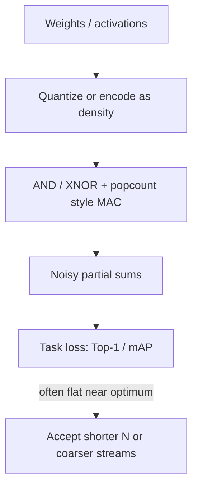

# Why AI Tolerates Bit Noise

Modern neural networks already live in a noisy world: quantized weights, dropout, stochastic gradient noise, and sensor imperfections. That is why **bitstream** and **unary** datapaths can replace wide multipliers for many inference kernels without collapsing task accuracy.

---

## Intuition

1. **Overparameterization** — many parameter directions barely affect the decision boundary.
2. **Nonlinearities absorb scale noise** — ReLU, sigmoid, and attention softmax care more about relative order than exact LSB values.
3. **Training can co-adapt** — networks trained (or fine-tuned) with noise models matching the hardware see smaller accuracy drops.

Stochastic / unary accelerators therefore optimize for **energy per inference at a target accuracy**, not zero arithmetic MSE.

---

## Typical SC / unary roles in learning hardware

| Block | Why SC / unary helps | Watch-outs |
| :--- | :--- | :--- |
| MAC / GEMM | Multiply ≈ AND / XNOR; accumulate by counting | RNG cost, correlation across lanes |
| Batch-norm / nonlinear | Cheap hybrid stochastic–binary engines | Dynamic range & early termination |
| CIM arrays | Density codes match analog / unary memory readout | Device variation vs stream model |
| Binarized nets | Already ±1 — bipolar SC is a natural fit | Scaling layers still need care |

---

## How to read the literature safely

Use the [PC Paper Map](https://probabilistic-computing.github.io/.github/) filtered to **Neural Networks & Learning**. Prefer papers that report:

- End-task accuracy (not only MAC MSE)
- Stream length $N$ or equivalent precision mode
- Whether training knew about the noise

This portal does **not** reproduce figures, tables, or abstracts from those papers — only educational summary and DOI links on the [Neural Networks taxonomy](../taxonomy/neural-networks.md) page.

---

## 📚 DOI starting points

- Digital stochastic CIM CNN processor (65 nm): [DOI 10.1109/JSSC.2025.3554554](https://doi.org/10.1109/JSSC.2025.3554554)
- Hybrid stochastic–binary batch-norm engine: [DOI 10.1109/TVLSI.2025.3602991](https://doi.org/10.1109/TVLSI.2025.3602991)
- Systolic random-increment memory for unary computing: [DOI 10.1109/TCAD.2026.3696809](https://doi.org/10.1109/TCAD.2026.3696809)
