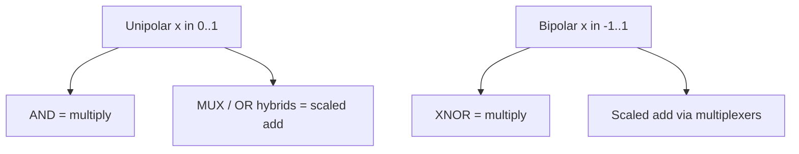

# Bitstream Encoding Made Easy

A stochastic number is not “random junk” — it is a **deliberate encoding** of a real value as the statistics of a bit sequence.

---

## Unipolar encoding

For $x \in [0,1]$:

$$P(X_t = 1) = x, \qquad \hat{x} = \frac{1}{N}\sum_{t=1}^{N} X_t$$

| Value $x$ | Example length-8 pattern (one draw) | Mean |
| ---: | :--- | ---: |
| 0.00 | `00000000` | 0 |
| 0.25 | `10001000` | 0.25 |
| 0.50 | `10101010` | 0.50 |
| 1.00 | `11111111` | 1 |

**Unipolar multiply** (independent streams): $X \land Y$ has mean $x\cdot y$.

---

## Bipolar encoding

For $x \in [-1,1]$:

$$P(X_t = 1) = \frac{x+1}{2}, \qquad x = 2\,P(X_t=1) - 1$$

**Bipolar multiply** (independent streams): $X \odot Y$ via `XNOR` yields mean $\approx x\cdot y$ on the bipolar scale.

---

## Generating streams (SNG sketch)

A common **stochastic number generator**:

1. Draw a uniform random integer $R_t$ each cycle (LFSR, TRNG, Sobol, …).
2. Compare to a binary register holding $x$.
3. Output bit $X_t = [R_t < x]$.

Deterministic variants replace $R_t$ with a low-discrepancy sequence so short $N$ still tracks $x$ closely. See [Number Generators](../taxonomy/number-generators.md).

---

## Decoding

Hardware usually **counts** 1s over a window (or uses progressive counters) and optionally renormalizes. Window choice sets the precision–latency trade-off covered in [Error, Precision & Latency](error-precision-latency.md).

---

## Try it

The [bitstream multiply lab](why-probabilistic-computing.md#interactive-lab-bitstream-multiply) on the “Why Probabilistic Computing?” page samples unipolar streams live in the browser.
