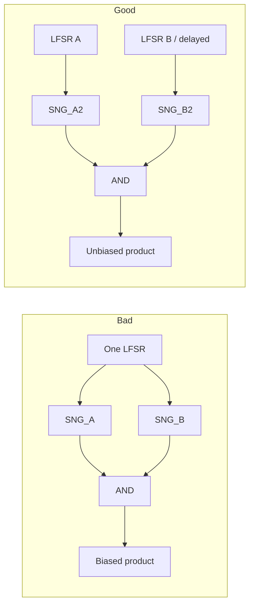

# Correlation & Independence

The most common silent bug in stochastic computing: **two streams that look random but share a seed**.

---

## Why independence matters

For unipolar independent Bernoulli streams,

$$\mathbb{E}[X_t \land Y_t] = \mathbb{E}[X_t]\,\mathbb{E}[Y_t] = x\,y.$$

If $X$ and $Y$ are **maximally correlated** (identical streams) and $x=y$, then $X\land Y = X$ and the “product” estimates $x$ instead of $x^2$.

---

## Sources of correlation

- Shared LFSR / RNG across SNGs
- Reusing the same bitstream for multiple operations without regeneration
- Feedback loops that re-inject partially correlated wires
- Poorly chosen deterministic sequences with structured pairwise dependence

---

## Design tactics (conceptual)

| Tactic | Idea |
| :--- | :--- |
| **Independent seeds** | Distinct LFSR states / polynomials per operand |
| **Decorrelation** | Shuffle, delay, or regenerating SNGs between stages |
| **Exploit correlation** | Some adders / polynomials *want* correlated inputs — design explicitly |
| **Deterministic joint construction** | Build multi-stream sets with controlled discrepancy |

Modern papers discuss in-stream correlation manipulation and low-discrepancy joint generation; start from the [Stochastic Arithmetic](../taxonomy/stochastic-arithmetic.md) and [Number Generators](../taxonomy/number-generators.md) citation lists.

---

## Mental model

Treat **correlation** as a first-class signal integrity problem — like metastability in async design. If a paper or design review does not state the independence assumptions of each gate, ask.
