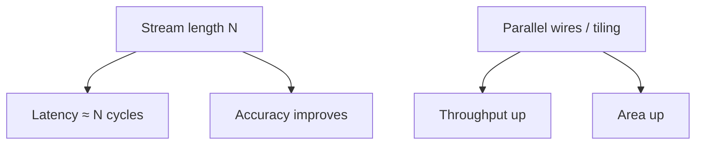

# Error, Precision & Latency

In binary arithmetic, precision is mostly **bit-width**. In stochastic computing, precision is mostly **how long you wait**.

---

## Estimator variance (i.i.d. unipolar)

If bits are i.i.d. Bernoulli($x$) and $\hat{x} = N^{-1}\sum_t X_t$, then

$$\mathrm{Var}(\hat{x}) = \frac{x(1-x)}{N}.$$

Worst-case variance is at $x=0.5$: $\mathrm{Var}=1/(4N)$. Root-mean-square error therefore scales like $1/(2\sqrt{N})$.

$$\text{Rough rule: } N \approx \frac{1}{4\,\varepsilon^2} \text{ for RMS }\varepsilon\text{ near }x=\tfrac12$$

| Target RMS $\varepsilon$ | Ballpark $N$ (i.i.d., $x\approx0.5$) |
| ---: | ---: |
| 0.05 | ~100 |
| 0.02 | ~625 |
| 0.01 | ~2500 |

Deterministic / low-discrepancy streams can beat this scaling for structured workloads — at the cost of more sophisticated SNGs.

---

## Latency vs throughput

Designers pick among:

1. **Long serial streams** — tiny area, high latency
2. **Parallel bitstreams** — $k$ wires ≈ $k\times$ throughput
3. **Hybrid stochastic–binary** — SC for cheap nonlinearities, binary for precision-critical paths

---

## Error types to separate

| Error | Cause | Mitigation |
| :--- | :--- | :--- |
| **Sampling variance** | Finite $N$ | Longer streams, low-discrepancy |
| **Correlation bias** | Dependent operands | Independent SNGs, decorrelation |
| **Quantization / clamping** | Encoding range | Bipolar vs unipolar choice |
| **Circuit faults** | SEU, stuck-at | Often softened by density coding |

---

## Reporting hygiene (for readers of papers)

When comparing designs via the [Paper Map](https://probabilistic-computing.github.io/.github/), check whether authors report:

- Stream length $N$ (or equivalent progressive counter depth)
- RNG / SNG type and sharing
- Application metric **and** arithmetic MSE
- Technology node and energy measurement method

Without those, “$10\times$ energy” claims are hard to interpret.
