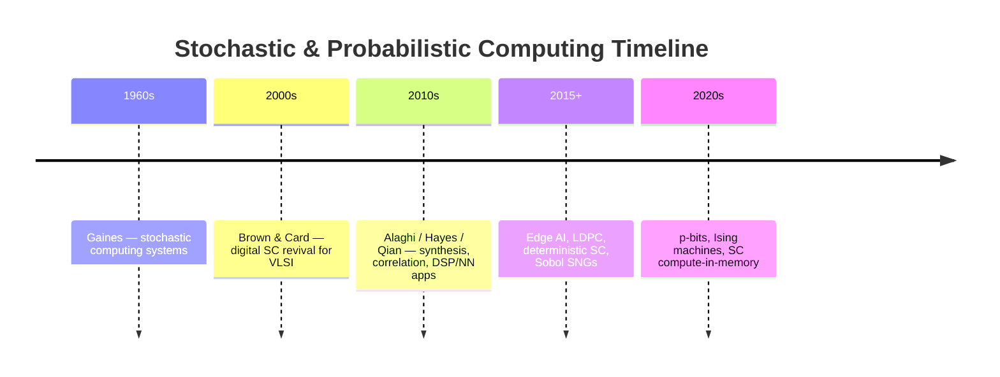

# History & Evolution

Probabilistic and stochastic computing is not new — it resurfaces whenever **energy**, **reliability**, or **massive parallelism** outrank cycle-by-cycle exactness.

---

## 1960s–1970s: Probability as a number format

Early SC treated a wire’s **duty cycle** (or Bernoulli rate) as the numeric value. Multiplication, scaling, and some nonlinearities collapsed to a few gates. The approach faded as binary VLSI scaled aggressively under Dennard scaling — exact wide datapaths became “free enough.”

---

## 2000s–2010s: VLSI revival

As power density and dark silicon rose, researchers revisited SC for:

- **Image processing** kernels that tolerate density noise
- **Neural network** inference with tiny MAC units
- **CAD / synthesis** of stochastic circuits (spectral methods, correlation-aware design)

Surveys and tutorials from this era remain the best entry points; look them up by DOI via the [Paper Map](https://probabilistic-computing.github.io/.github/) and classic IEEE search terms (*stochastic computing*, *stochastic logic*).

---

## Mid-2010s onward: Determinism, coding, and learning

Three threads dominate modern literature (reflected in this portal’s taxonomies):

1. **Better streams** — low-discrepancy and deterministic bitstreams shrink $N$ for a target MSE.
2. **Application engines** — stochastic LDPC / MIMO detectors and CNN / BNN accelerators.
3. **Beyond classical SC** — **p-bits** and invertible networks for combinatorial optimization and sampling.

---

## Relation to inexact / approximate computing

| Idea | Approximate binary | Stochastic / probabilistic |
| :--- | :--- | :--- |
| Error model | Truncation / logic approximation | Sampling variance + correlation bias |
| Typical unit | Approx adder / multiplier cell | Gate + SNG + counter |
| Knob | Bit significance, compressor truth table | Stream length $N$, RNG quality |

Both families serve error-resilient apps; they are complementary. See also the [Inexact Computing portal](https://inexact-computing.github.io/public/).

---

## 📚 Pointers (DOI only)

Foundational and survey-style entry points (publisher pages; no PDFs hosted here):

- B. R. Gaines, early stochastic computing systems literature (search IEEE / historical reprints).
- B. D. Brown and H. C. Card, *Stochastic Neural Computation*, IEEE Trans. Computers — [DOI 10.1109/12.954505](https://doi.org/10.1109/12.954505).
- A. Alaghi and J. P. Hayes, *Survey of Stochastic Computing*, ACM TECS — [DOI 10.1145/2465787.2465794](https://doi.org/10.1145/2465787.2465794).
- W. Qian et al., *An Architecture for Fault-Tolerant Computation with Stochastic Logic*, IEEE Trans. Computers — [DOI 10.1109/TC.2010.202](https://doi.org/10.1109/TC.2010.202).
