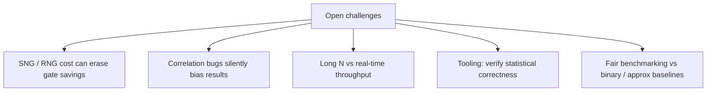

# Motivations & Grand Challenges

Why revisit bitstreams and p-bits now — and what still blocks wide adoption.

---

## Motivations

### 1. Energy and area at the edge
Always-on sensors and tiny ML models need MACs that fit in microwatts. SC / unary datapaths replace wide multipliers with AND–accumulate structures when latency budgets allow.

### 2. Soft-error softening
A single-event upset that flips one bitstream bit changes the decoded value by about $1/N$. The same upset on a binary MSB can be catastrophic. This motivates SC study in reliability-focused venues.

### 3. Native match to iterative algorithms
Belief propagation, MCMC, and Boltzmann machines already think in probabilities. Hardware that *is* probabilistic can avoid expensive digital RNG + float pipelines.

### 4. New devices
Magnetic tunnel junctions and other stochastic nanoscale devices naturally behave like **p-bits**, renewing interest in Ising / sampling machines beyond classical CMOS SC.

---

## Grand challenges

| Challenge | Why it hurts | Research directions (high level) |
| :--- | :--- | :--- |
| **RNG tax** | Every operand needs entropy or a long LFSR | Shared / deterministic SNGs, DRAM-compatible B2S |
| **Correlation** | Shared seeds → wrong products | Decorrelators, ECO-style in-stream fixes |
| **Latency** | Accuracy $\propto N$ for i.i.d. streams | Low-discrepancy codes, early termination |
| **Verification** | Bugs are statistical, not Boolean | Analytical MSE bounds + Monte Carlo harnesses |
| **Apples-to-apples** | Papers differ in $N$, PDK, app metric | Report energy×MSE and end-task accuracy |

---

## Designer’s checklist

1. Is the **application metric** (PSNR, Top-1, BER) OK with density noise?
2. Is the **SNG + wire** energy still lower than a binary / approximate unit at the same quality?
3. Are streams **independent** where gates assume independence?
4. Can you shrink $N$ with **deterministic** sequences without exploding area?

---

## 📚 Recent DOI pointers

Browse full lists by domain on the [Paper Map](https://probabilistic-computing.github.io/.github/). Examples:

- SC compute-in-memory CNN silicon: [DOI 10.1109/JSSC.2025.3554554](https://doi.org/10.1109/JSSC.2025.3554554)
- Energy-efficient stochastic LDPC: [DOI 10.1109/TVLSI.2024.3488716](https://doi.org/10.1109/TVLSI.2024.3488716)
- p-bit / Ising machine silicon: [DOI 10.1109/JSSC.2026.3699984](https://doi.org/10.1109/JSSC.2026.3699984)
