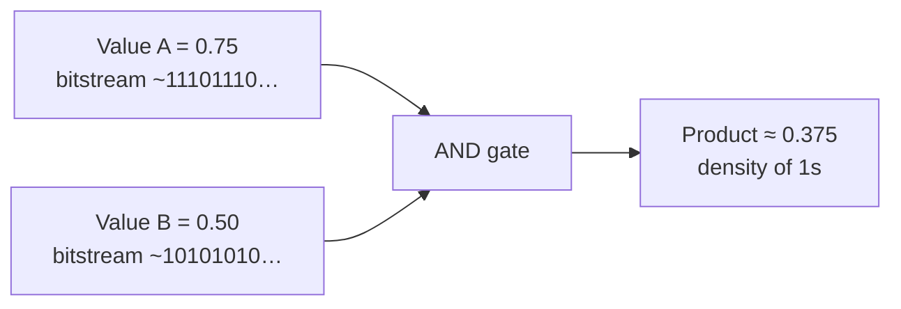

# Why Probabilistic Computing?

Imagine you need to multiply two numbers that each lie between 0 and 1 — say image pixel intensities, neural activations, or channel soft-bits. In classical binary arithmetic you build a wide multiplier array. In **stochastic computing (SC)** you instead encode each value as a **random bitstream** whose density of 1s equals that value, then multiply with a **single AND gate**.



The catch: you wait $N$ clock cycles for a good estimate, and the answer is **noisy**. When the application already tolerates noise — neural nets, vision, iterative decoding — that trade can win on **area and energy**.

---

## The energy intuition

CMOS energy is paid per toggled transistor. A 16×16 binary multiplier toggles thousands of gates every cycle. An SC multiplier toggles **one gate** per cycle for $N$ cycles. If $N$ is modest (tens to hundreds) and the rest of the SoC is memory-bound or already approximate, SC can be attractive.

$$E_{\text{SC-mult}} \approx N \cdot E_{\text{AND}} \quad\text{vs}\quad E_{\text{bin-mult}} \approx E_{\text{array}}$$

SC also pairs naturally with **compute-in-memory** and **unary** datapaths where values are already pulse-density coded.

---

## What you get — and what you pay

```
+------------------------------------------------------------------+
|  WIN: tiny arithmetic · soft-error softening · easy nonlinearity |
|  PAY: latency (N cycles) · RNG / SNG cost · correlation bugs     |
+------------------------------------------------------------------+
```

| Property | Binary exact | Stochastic / probabilistic |
| :--- | :--- | :--- |
| Multiply (unipolar) | Large array | `AND` (if independent) |
| Add (scaled) | Adder tree | MUX / OR / accumulator hybrids |
| Precision | Bit-width $W$ | Stream length $N$ (and encoding) |
| Errors | Hard faults hurt MSB | Many flips → small density change |

---

## Interactive lab: bitstream multiply

Drag the two probabilities and watch an `AND`-based unipolar multiplier estimate the product from a finite stream:

<iframe
  src="../../labs/bitstream-multiply.html"
  title="Bitstream Multiply Lab"
  style="width: 100%; height: 640px; border: none; background: transparent; margin: 12px 0;"
  loading="lazy"
></iframe>

---

## Where to go next

- [Bitstream Encoding Made Easy](bitstream-encoding.md) — unipolar vs bipolar
- [Correlation & Independence](correlation-and-independence.md) — why shared LFSRs break products
- [Hardware Taxonomies](../taxonomy/stochastic-arithmetic.md) — circuit families with DOI citations

!!! tip "Literature without PDFs"
    Browse curated titles and DOIs on the [PC Paper Map](https://probabilistic-computing.github.io/.github/). This portal never hosts publisher PDFs.
