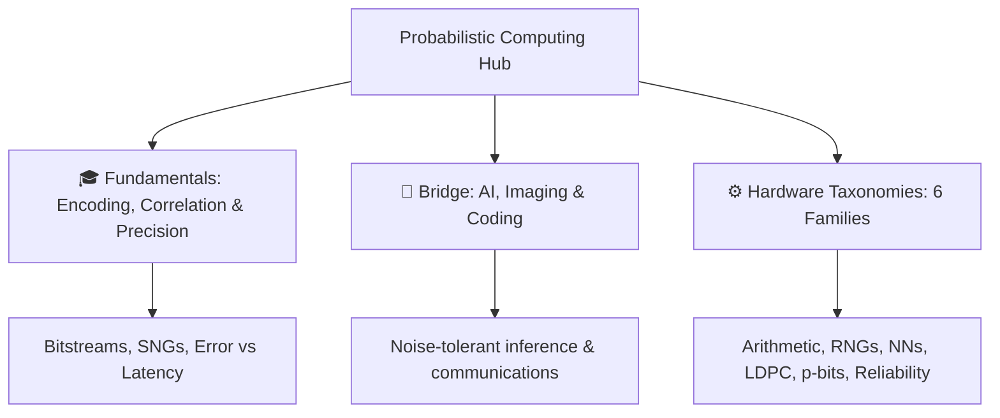

# Probabilistic Computing Learning & Research Portal

Welcome to the **Probabilistic Computing Learning and Research Portal**, an open-access educational resource for **stochastic computing**, **bitstream arithmetic**, and **probabilistic (p-bit) hardware**.

---

## 🎯 Objectives & Scope

Probabilistic and stochastic computing represent numbers as **random bitstreams** (or as tunable random bits) so that **simple logic gates** implement expensive arithmetic and inference kernels — trading latency and statistical variance for area and energy:

- **Neural Networks & Edge AI** (unary / stochastic MAC, batch-norm, CIM accelerators)
- **Coding & Communications** (stochastic LDPC / belief-propagation decoding)
- **DSP & Imaging** (filters, thresholding, transforms on bitstreams)
- **Combinatorial / Ising-style solvers** (invertible logic and p-bit networks)

---

## 📚 Navigation Guide

| Section | Description |
| :--- | :--- |
| [**Glossary**](glossary.md) | Plain-English definitions of SC / p-bit terms and acronyms. |
| [**Fundamentals**](fundamentals/why-probabilistic-computing.md) | Why bitstreams buy energy, [history](fundamentals/history-and-evolution.md), [challenges](fundamentals/motivations-and-challenges.md), encoding, correlation, and precision–latency trade-offs. |
| [**Bridge to Real World**](bridge/ai-and-bitstream-math.md) | Why learning systems and codecs tolerate bitstream noise. |
| [**Hardware Taxonomies**](taxonomy/stochastic-arithmetic.md) | Architectural overviews with **DOI citations** across arithmetic, RNGs, neural nets, coding, p-bits, and fault tolerance. |

---

## 🔎 Literature (citation-safe)

This portal teaches concepts in original language and points to peer-reviewed work via **DOI links only**. It does **not** host PDFs or reproduce copyrighted paper content.

Browse titles, venues, and publisher abstracts on the public **[PC Paper Map](https://probabilistic-computing.github.io/.github/)** (105+ curated entries).

---

## 🔬 Repository & Source

- **GitHub Repository**: [Probabilistic-Computing/public](https://github.com/Probabilistic-Computing/public)
- **Organization**: [Probabilistic-Computing](https://github.com/Probabilistic-Computing)
- **Paper Map**: [probabilistic-computing.github.io/.github](https://probabilistic-computing.github.io/.github/)
- **License**: CC BY 4.0 (Creative Commons Attribution 4.0 International)

!!! note "Sibling portal"
    For approximate / inexact *deterministic* arithmetic (truncated multipliers, approximate adders, etc.), see the [Inexact Computing Learning & Research Portal](https://inexact-computing.github.io/public/).
