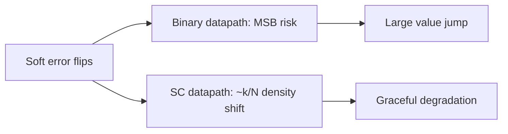

# Fault Tolerance

A classic argument for stochastic representation: information is spread across $N$ bits, so many soft errors become **small density errors** instead of catastrophic MSB failures.

---

## Soft-error intuition

Flipping $k$ bits in a unipolar stream changes the decoded value by at most $k/N$. For large $N$, random SEUs look like extra variance — often cheaper to ride through than to harden every binary register bit.

---

## What reliability papers typically compare

| Axis | Questions to ask |
| :--- | :--- |
| Fault model | Stuck-at, SEU rate, aging |
| Metric | Output MSE vs application BER / accuracy |
| Cost | Extra SNG / redundancy energy |
| Baseline | Binary vs SC at iso-quality |

SC is not automatically “more reliable” — poorly correlated or too-short streams can fail task metrics even with soft errors ignored. Reliability must be measured **end-to-end**.

---

## Overlap with other taxonomies

- Parallel SC multipliers for BNNs often discuss error resilience alongside energy.
- Beyond-von-Neumann bitstream processing surveys position SC inside broader unreliable-device contexts.

---

## 📚 Primary literature (DOI only)

- Circuit reliability: SC vs binary computing: [DOI 10.1109/TCSII.2020.2993273](https://doi.org/10.1109/TCSII.2020.2993273)
- SC in beyond von-Neumann era (bitstream processing): [DOI 10.1109/TCSII.2022.3161995](https://doi.org/10.1109/TCSII.2022.3161995)
- Energy-efficient binary-stochastic multipliers: [DOI 10.1109/TCSII.2022.3210035](https://doi.org/10.1109/TCSII.2022.3210035)
- Cost/speed co-optimized parallel SC multiplier (BNN context): [DOI 10.1109/TCSII.2025.3562199](https://doi.org/10.1109/TCSII.2025.3562199)

Domain browse: [Paper Map → Fault Tolerance & Reliability](https://probabilistic-computing.github.io/.github/).
