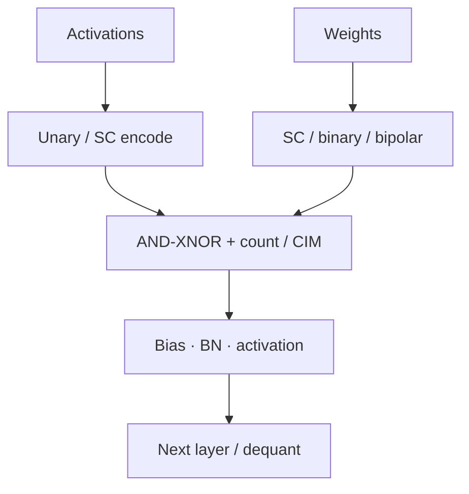

# Neural Networks & Learning

Largest modern application cluster in the curated catalog: accelerating inference (and sometimes training-related kernels) with stochastic, unary, or hybrid bit-serial datapaths.

---

## Architectural patterns

| Pattern | Idea |
| :--- | :--- |
| **SC-MAC arrays** | Replace multipliers with gate-level products + popcount |
| **Hybrid stochastic–binary** | Keep sensitive paths binary (e.g. BN / residuals) |
| **Unary systolic / CIM** | Pulse-density codes inside memory-centric tiles |
| **BNN-friendly bipolar** | ±1 weights map cleanly to XNOR-popcount |

---

## Evaluation checklist

When reading NN+SC papers (titles/DOIs on the Paper Map):

1. Dataset and **task accuracy** vs binary baseline  
2. Stream length or precision mode  
3. Training aware of hardware noise?  
4. Energy includes SNGs and memory?  

Educational background: [Why AI Tolerates Bit Noise](../bridge/ai-and-bitstream-math.md).

---

## 📚 Primary literature (DOI only)

- 65 nm digital stochastic CIM CNN processor: [DOI 10.1109/JSSC.2025.3554554](https://doi.org/10.1109/JSSC.2025.3554554)
- Hybrid stochastic–binary batch-norm engine: [DOI 10.1109/TVLSI.2025.3602991](https://doi.org/10.1109/TVLSI.2025.3602991)
- Systolic random-increment memory for unary computing: [DOI 10.1109/TCAD.2026.3696809](https://doi.org/10.1109/TCAD.2026.3696809)
- Multivariate nonlinear function modules (SC-oriented): [DOI 10.1109/TVLSI.2026.3662674](https://doi.org/10.1109/TVLSI.2026.3662674)

Browse all NN entries: [Paper Map → Neural Networks & Learning](https://probabilistic-computing.github.io/.github/).
