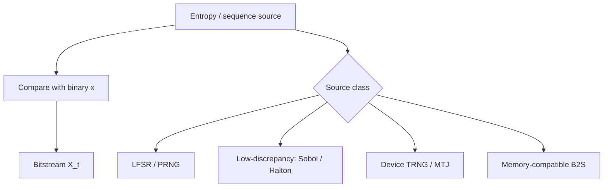

# Number Generators (RNG / SNG)

In stochastic computing, **entropy and encoding** often dominate area and energy. A beautiful one-gate multiplier loses if every operand needs an expensive stochastic number generator.

---

## Roles

| Block | Job |
| :--- | :--- |
| **RNG** | Provide (pseudo)uniform bits / words |
| **SNG / B2S** | Map binary value $x$ → density-$x$ stream |
| **Shared vs private** | Trade area against correlation risk |

---

## Design axes

1. **Statistical quality** — period, pairwise independence, spectral artifacts
2. **Area / power** — LFSR bit width, sharing factor, TRNG amplifiers
3. **Determinism** — reproducibility for test; low-discrepancy for short $N$
4. **Technology coupling** — DRAM-friendly converters, spintronic TRNGs, CIM-friendly pulse codes

---

## Practical rules of thumb

- Budget **SNG energy per bit** in every comparison against binary baselines.
- Never share one LFSR across both inputs of an `AND` multiplier unless you have proven the bias is acceptable.
- For short-$N$ DSP / NN, evaluate **deterministic** sequences before lengthening streams.

---

## 📚 Primary literature (DOI only)

- Low-cost high-accuracy random number source for SC: [DOI 10.1109/TCAD.2025.3585800](https://doi.org/10.1109/TCAD.2025.3585800)
- DRAM-compatible deterministic B2S conversion: [DOI 10.1109/TCSI.2026.3701420](https://doi.org/10.1109/TCSI.2026.3701420)
- Spintronic tunable TRNG design: [DOI 10.1109/TCAD.2024.3446715](https://doi.org/10.1109/TCAD.2024.3446715)
- Probabilistic CIM for MCMC: [DOI 10.1109/TCSI.2023.3337529](https://doi.org/10.1109/TCSI.2023.3337529)

Domain filter: [Paper Map → Number Generators](https://probabilistic-computing.github.io/.github/).
