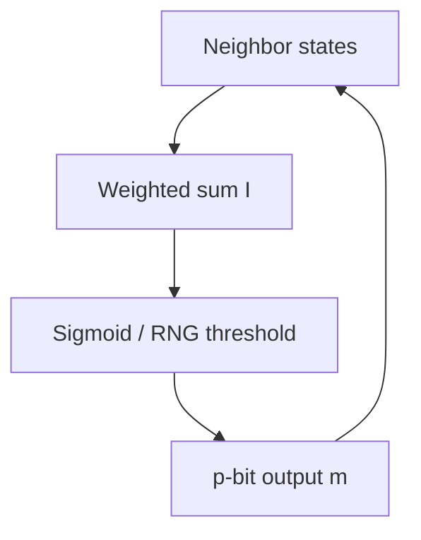

# Invertible & p-bit Logic

Beyond classical bitstream SC, **probabilistic bits (p-bits)** and invertible logic networks target sampling and combinatorial optimization (Ising / QUBO-style workloads).

---

## p-bit in one equation

A common abstract model:

$$P(m = 1) = \sigma\!\left(\frac{I}{kT}\right) = \frac{1}{1+e^{-I/kT}}$$

where $I$ is a real-valued input (weighted sum of neighbor states) and $m\in\{0,1\}$ (or $\pm1$) is the random output. Networks of coupled p-bits approximate Boltzmann machines / Ising solvers in hardware.

---

## Invertible logic (concept)

Clamp some terminals to desired outputs; the network’s steady-state distribution concentrates on inputs (or complete assignments) that satisfy the encoded constraints. Useful mental model: **hardware that runs a soft SAT / Ising solver continuously**.

---

## Engineering themes in recent work

| Theme | Why it matters |
| :--- | :--- |
| Non-idealities | Device variation changes effective temperature / bias |
| Fault tolerance | Broken p-bits vs graceful degradation |
| 3D / dense Ising machines | Throughput in TELOPS-class metrics |
| Majority / logic embeddings | Map NP-hard problems onto p-bit fabrics |

This page stays conceptual — read silicon and algorithm details on publisher DOI pages.

---

## 📚 Primary literature (DOI only)

- 3-D Ising machine (JSSC): [DOI 10.1109/JSSC.2026.3699984](https://doi.org/10.1109/JSSC.2026.3699984)
- Fault-tolerant p-bit design framework: [DOI 10.1109/TCSI.2025.3569769](https://doi.org/10.1109/TCSI.2025.3569769)
- p-bit probabilistic majority logic for NP-hard problems: [DOI 10.1109/TCAD.2026.3729920](https://doi.org/10.1109/TCAD.2026.3729920)
- Non-idealities in probabilistic computing: [DOI 10.1109/TCSI.2024.3461770](https://doi.org/10.1109/TCSI.2024.3461770)

Domain browse: [Paper Map → Invertible & p-bit Logic](https://probabilistic-computing.github.io/.github/).
