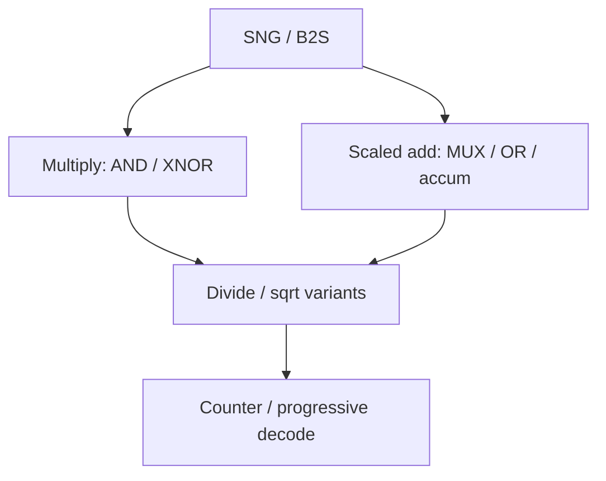

# Stochastic Arithmetic

Core building blocks that turn bitstream densities into multiply, add, divide, and simple nonlinear functions using a handful of gates plus counters.

---

## Multiply

| Encoding | Gate (independent streams) | Notes |
| :--- | :--- | :--- |
| Unipolar | `AND` | Mean $xy$ |
| Bipolar | `XNOR` | Mean $xy$ on $[-1,1]$ scale |

Parallelism: replicate wires or use parallel stochastic multipliers when $N$ would otherwise dominate latency. See also correlation pitfalls in [Correlation & Independence](../fundamentals/correlation-and-independence.md).

---

## Add and accumulate

Exact unipolar addition is not a single OR gate (that implements a noisy noisy-OR / saturating mix). Common patterns:

- **MUX add** — select between streams with probability $\alpha$ to implement $\alpha x + (1-\alpha)y$
- **Counter-based add** — decode to binary, add, optionally re-encode
- **Hybrid** — keep accumulation in binary / thermometer domains

---

## Divide, mean, square-root

Division and roots need more structure (often counters, reciprocals, or iterative SC units). Recent literature explores counting-based dividers and dedicated mean / sqrt circuits for DSP pipelines — cite via DOI below rather than copying schematics from papers.

---

## Correlation-aware arithmetic

Some designs **intentionally** correlate streams (polynomial evaluation, certain DSP transforms). Others insert **in-stream decorrelation** so deep pipelines do not accumulate bias. Treat correlation policy as part of the microarchitecture, not an afterthought.

---

## Try the multiply lab

<iframe
  src="../../labs/bitstream-multiply.html"
  title="Bitstream Multiply Lab"
  style="width: 100%; height: 640px; border: none; background: transparent; margin: 12px 0;"
  loading="lazy"
></iframe>

---

## 📚 Primary literature (DOI only)

- Fast counting-based SC divider: [DOI 10.1109/TCAD.2024.3365426](https://doi.org/10.1109/TCAD.2024.3365426)
- Mean and square-root SC circuits: [DOI 10.1109/TCSII.2025.3560332](https://doi.org/10.1109/TCSII.2025.3560332)
- In-stream correlation manipulation (ECO): [DOI 10.1109/TVLSI.2025.3597779](https://doi.org/10.1109/TVLSI.2025.3597779)
- Counter-based addition for SC: [DOI 10.1109/TCSII.2025.3642988](https://doi.org/10.1109/TCSII.2025.3642988)
- Parallel stochastic multiplier: [DOI 10.1109/TVLSI.2026.3722919](https://doi.org/10.1109/TVLSI.2026.3722919)

Full domain browse: [Paper Map → Stochastic Arithmetic & Circuits](https://probabilistic-computing.github.io/.github/).
